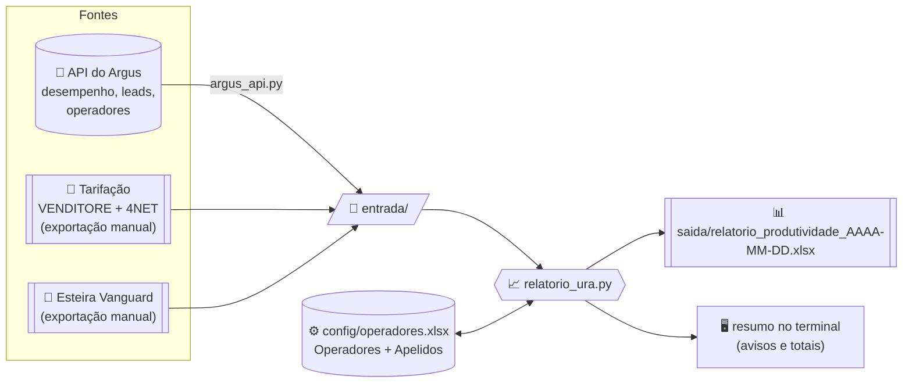

<div align="center">

# ⛩️ BENZAITEN

### 弁財天 · Automação de relatórios da Benconsig

*“Que os dados fluam — e as vendas também.”*

**Relatório de produtividade da URA · Escala de bases do Ativo 2 · Integração com o Argus**

Scripts em Python que substituem as rotinas diárias feitas à mão no Excel.


</div>

> **Por que BENZAITEN?** Na mitologia japonesa, **Benzaiten** (弁財天) é uma das Sete Divindades
> da Sorte: a deusa de **tudo o que flui**, como a água, as palavras, o conhecimento e a **riqueza**.
> É o que este projeto faz: as exportações entram, os dados fluem e saem relatórios de vendas
> prontos todos os dias. E o **Ben** de **Ben**consig já estava no nome dela.

---

> [!WARNING]
> **Este repositório é público.** Nunca envie para o GitHub planilhas, CSVs ou qualquer arquivo
> das pastas `entrada/`, `anonimizados/`, `config/`, `saida/` e `historico/`.
> O `.gitignore` bloqueia isso no `git`, mas **o botão "Upload files" do site do GitHub ignora
> o `.gitignore`**. Não use esse botão.

## 📑 Sumário

1. [Visão geral](#-visão-geral)
2. [Situação do projeto](#-situação-do-projeto)
3. [Instalação](#-instalação-só-na-primeira-vez)
4. [Rotina diária (resumo)](#-rotina-diária-resumo)
5. [Relatório de produtividade da URA](#-relatório-de-produtividade-da-ura)
6. [API do Argus](#-api-do-argus)
7. [Escala de bases do Ativo 2](#-escala-de-bases-do-ativo-2)
8. [Anonimização](#-anonimização)
9. [Privacidade e segurança](#-privacidade-e-segurança)
10. [Problemas comuns](#-problemas-comuns)
11. [Para quem for manter o código](#-para-quem-for-manter-o-código)
12. [Glossário](#-glossário)

---

## 🔭 Visão geral

| Script | Para que serve | Quando rodar |
|---|---|---|
| 📈 `relatorio_ura.py` | Gera o relatório de produtividade da URA (TMA, TMO, leads, custo, vendas, clientes) | Todo dia útil |
| 🔌 `argus_api.py` | Baixa do Argus o desempenho, os leads da URA e o cadastro de operadores | Automático (o relatório chama sozinho) |
| 🎲 `escala_bases.py` | Sorteia as bases do INSS entre os grupos dos supervisores do Ativo 2 | Todo dia útil |
| 🕶️ `anonimizar.py` | Remove CPFs e dados pessoais das exportações | Só antes de compartilhar arquivos |
| 🧰 `leitura.py` | Funções comuns (ler CSV/Excel, converter "R$ 1.234,56", datas, nomes) | Usado pelos outros |

### Como os dados fluem



### Estrutura de pastas

```
automa-relat-rios/
├── 📈 relatorio_ura.py      relatório da URA
├── 🔌 argus_api.py          download pela API do Argus
├── 🎲 escala_bases.py       sorteio das bases do Ativo 2
├── 🕶️ anonimizar.py         remove dados pessoais das exportações
├── 🧰 leitura.py            funções comuns de leitura e conversão
├── 🧪 tests/                testes automáticos (só dados inventados)
├── requirements.txt         bibliotecas necessárias
│
│   ── pastas criadas no seu computador (NUNCA vão para o GitHub) ──
├── 📁 entrada/              exportações do dia (Argus e Vanguard)
├── 📁 anonimizados/         cópias sem dados de clientes
├── 📁 config/               operadores.xlsx, bases.xlsx, argus_token.txt
├── 📁 saida/                relatórios e escalas gerados
└── 📁 historico/            histórico acumulado das escalas
```

As pastas `entrada/`, `saida/` e `historico/` são criadas sozinhas quando o script precisa.
A `config/` você cria na primeira vez (veja abaixo).

---

## 🚦 Situação do projeto

| Parte | Situação | Detalhe |
|---|---|---|
| 🎲 Escala de bases | ✅ **Pronta e em uso** | Testada com a planilha `.xlsm` real e o histórico importado |
| 🕶️ Anonimização | ✅ **Pronta e em uso** | Testada com a esteira real (997 CPFs substituídos, conferência sem pendências) |
| 📈 Relatório — TMA, TMO, leads, custos | ✅ **Validado** | Comparado com a planilha `Relatorio_Produtividade_URA_Automatico.xlsx` de 07/10/2026: **241 valores, 0 diferenças** |
| 📈 Relatório — vendas e clientes | 🟡 **Falta conferir** | Regra implementada e testada com dados fictícios; falta comparar com uma esteira real anonimizada |
| 🔌 API do Argus — conexão | ✅ **Funcionando** | Conexão, token e diagnóstico testados no computador da empresa |
| 🔌 API do Argus — fórmulas | 🟡 **Falta conferir** | TMA/TME (média ponderada) e leads (`qtdeAtendimentoTotal` do grupo URA) precisam ser comparados com a exportação manual do mesmo dia |
| 📄 Tarifação | ⚪ **Manual** | Não existe na API do Argus: continua sendo exportada à mão |

> [!NOTE]
> Os dois itens 🟡 têm um roteiro de conferência na seção
> [Para quem for manter o código](#-para-quem-for-manter-o-código).

---

## 🔧 Instalação (só na primeira vez)

<details open>
<summary><b>1. Instalar o Python</b></summary>

1. Baixe o Python 3.10 ou mais novo em <https://www.python.org/downloads/>.
2. Na instalação, **marque a opção "Add Python to PATH"**. Sem isso, o comando `python` não funciona no terminal.
3. Para conferir, abra o PowerShell e digite:
   ```powershell
   python --version
   ```

</details>

<details open>
<summary><b>2. Baixar o projeto</b></summary>

**Com git** (recomendado, porque depois é só usar `git pull` para atualizar):

```powershell
cd C:\
git clone https://github.com/nanzinx/automa-relat-rios
cd automa-relat-rios
```

**Sem git:** no GitHub, clique em **Code → Download ZIP**, extraia e abra o PowerShell dentro da pasta
(no Explorador: clique na barra de endereço, digite `powershell` e aperte Enter).

</details>

<details open>
<summary><b>3. Instalar as bibliotecas</b></summary>

```powershell
pip install -r requirements.txt
```

Isso instala `pandas`, `openpyxl`, `xlrd` e `pytest`. A conexão com o Argus usa só o que já vem com o Python.

</details>

<details open>
<summary><b>4. Criar a pasta <code>config</code> e configurar o Argus</b></summary>

```powershell
mkdir config
notepad config\argus_token.txt
```

O Bloco de Notas pergunta se quer criar o arquivo: clique em **Sim**, cole o token
(Argus → **Configurações → Desenvolvedor → Acesso API**), salve e feche.

Teste a conexão:

```powershell
python argus_api.py --diagnostico
```

Deve aparecer a lista de grupos operacionais e os campos do desempenho.

</details>

<details>
<summary><b>5. (Opcional) Conferir se está tudo certo</b></summary>

```powershell
python -m pytest
```

Todos os testes devem aparecer como `passed`.

</details>

---

## ⏰ Rotina diária (resumo)

```text
┌──────────────────────────────────────────────────────────────────────┐
│ 1. Apagar os arquivos do dia anterior em entrada\                    │
│ 2. Exportar para entrada\:                                           │
│      • Esteira do Vanguard                                           │
│      • Tarifação VENDITORE   (Argus > Tarifação > Painel)            │
│      • Tarifação 4NET        (Argus > Tarifação > Painel)            │
│ 3. python relatorio_ura.py      → saida\relatorio_produtividade_...  │
│ 4. python escala_bases.py       → saida\escala_...                   │
└──────────────────────────────────────────────────────────────────────┘
```

O desempenho (TMA/TMO), os leads da URA e o cadastro de operadores **não precisam ser exportados**:
o relatório baixa pela API do Argus.

---

## 📈 Relatório de produtividade da URA

### Como rodar

```powershell
python relatorio_ura.py
```

| Situação | Comando |
|---|---|
| Relatório do último dia útil (padrão) | `python relatorio_ura.py` |
| Relatório de outro dia (ex.: depois de feriado) | `python relatorio_ura.py --data 17/10/2026` |
| Não usar a API (todos os arquivos exportados à mão) | `python relatorio_ura.py --sem-api` |

> [!TIP]
> **Último dia útil:** de terça a sexta, é o dia anterior; na segunda-feira (e no fim de semana), é a **sexta**.
> Feriados não entram na conta: nesses casos use `--data`.

### O que o script faz, passo a passo

1. **Lê todos os arquivos de `entrada\`** (CSV, XLSX ou XLS) e descobre o tipo de cada um **pelas colunas**,
   não pelo nome. Pode chamar o arquivo do jeito que quiser.
2. **Baixa do Argus** o desempenho e os leads do dia, se ainda não estiverem em `entrada\`.
3. **Atualiza o cadastro** (`config\operadores.xlsx`) com a exportação de operadores mais recente.
4. **Calcula** as colunas do relatório (tabela abaixo).
5. **Grava** `saida\relatorio_produtividade_AAAA-MM-DD.xlsx` e mostra um resumo no terminal.

| Arquivo em `entrada\` | Reconhecido pelas colunas |
|---|---|
| Desempenho (TMA/TME) | `Data`, `Operador`, `TME`, `TMA` |
| Leads da URA | `Data`, `Operador`, `Leads. Atend.` |
| Tarifação (VENDITORE e 4NET) | `Descrição`, `Valor R$`, `Minutos` |
| Operadores | `Nome`, `Supervisor(es)`, `Status` |
| Esteira do Vanguard | `CPF`, `Etapa`, `Agente`, `Data/Hora` |

> [!IMPORTANT]
> As tarifações **não têm data**. Todas as que estiverem em `entrada\` são somadas.
> Apague as do dia anterior antes de rodar. Se houver mais de 2, o script avisa.
> O desempenho e os leads de **outros dias** são ignorados automaticamente.

### Como cada coluna é calculada

| Coluna | Fonte | Cálculo |
|---|---|---|
| **TMA** | Argus › Desempenho Operadores | Coluna TMA. Na equipe: **soma** dos operadores (conforme o procedimento) |
| **TMO** | Argus › Desempenho Operadores | Coluna TME. Na equipe: **soma** dos operadores |
| **Leads atendidos/URA** | Argus › Desempenho › grupo RECEPTIVO - URA | Coluna Leads. Atend. |
| **Custo total** | Tarifação VENDITORE + 4NET | Custo do operador **+** sua parte do custo dos robôs da URA |
| **Vendas geral** | Esteira do Vanguard | Soma do Valor Contrato das etapas **Andamento, Pendente e Pago** com Data/Hora no dia do relatório |
| **Cliente efetivados** | Esteira do Vanguard | CPFs **diferentes** com etapa **Andamento ou Pago** |
| **Custo por CPF** | — | Custo total ÷ clientes efetivados (0 se não houver clientes) |
| **Produção/lead** | — | Vendas geral ÷ leads (0 se não houver leads) |

<details>
<summary><b>💰 Como a tarifação é distribuída (clique para ver)</b></summary>

Cada linha da tarifação é classificada assim:

| A linha começa com… | Classificação | Para onde vai |
|---|---|---|
| `<LIGAÇÕES SEM DERIVAÇÃO P/ OPERADOR>` | Sem derivação | Linha própria no relatório e no **TOTAL GERAL** (não é rateada) |
| `<` (outros) | Linha de total | Ignorada |
| `OPER VIRT…` ou `OPERADOR VIRT…` | Robô da URA | Rateada entre os operadores **na proporção dos leads** |
| Nome de operador do cadastro | Consultor | Custo direto do operador |
| Nome fora do cadastro | Ex-colaborador / sem vínculo | Ignorada e listada nos avisos |

**Exemplo do rateio:** se os robôs custaram R$ 40,00 e só duas pessoas atenderam leads da URA
(Ana com 30 e Bruno com 10), a Ana recebe R$ 30,00 e o Bruno R$ 10,00.

Valores em formato brasileiro (`R$ 1.234,56`, `10,50`, `1,3`) são convertidos corretamente.

</details>

### Ordem e layout

| # | Bloco | Ordem | Cor |
|---|---|---|---|
| 1 | Operadores | De quem **mais vendeu** para quem menos vendeu (empate: mais leads) | Branco, com linhas alternadas em azul-claro |
| 2 | Separador | — | 🟨 Amarelo |
| 3 | `TOTAL EQUIPE - …` | Pela venda da equipe (empate: ordem alfabética) | ⬜ Cinza, negrito |
| 4 | `TOTAL OPERADORES` | — | Cinza escuro, texto azul |
| 5 | `LIGAÇÕES SEM DERIVAÇÃO P/ OPERADOR` | — | Amarelo-claro |
| 6 | `TOTAL GERAL (c/ sem derivação)` | — | 🟦 Azul, texto branco |

- Só aparecem operadores **com atividade** (leads, custo, vendas ou clientes).
  Para mostrar todos, mude `MOSTRAR_TODOS = True` no início do `relatorio_ura.py`.
- A **equipe** é o primeiro nome do supervisor no Argus (ex.: supervisor "FULANO DE TAL" → equipe "Fulano").
- A planilha tem uma segunda aba, **Conferência**, com os arquivos lidos, a conferência dos custos
  (importado × relatório × ignorado), os nomes sem vínculo e os avisos.

### 👥 Cadastro de operadores e apelidos

O arquivo `config\operadores.xlsx` é criado e atualizado sozinho. Ele tem duas abas:

| Aba | Quem preenche | Para que serve |
|---|---|---|
| **Operadores** | O script (a partir do Argus) | Nome, supervisor, equipe e status. **Não edite**: é sobrescrita a cada atualização |
| **Apelidos** | **Você** | Liga um nome escrito diferente em outro sistema ao nome oficial do Argus |

**Exemplo da aba Apelidos:**

| Nome no sistema | Nome oficial |
|---|---|
| JOANA SOUSA | JOANNA SOUSA |

> [!NOTE]
> Acentos, maiúsculas e espaços extras **já são ignorados** (`Cauã` = `CAUA`).
> Mas grafias diferentes (`JOANA` × `JOANNA`) **nunca** são ligadas automaticamente:
> o script lista esses casos em **"NOMES SEM VÍNCULO"** para você decidir.

| No final aparece… | Significa | O que fazer |
|---|---|---|
| **NOMES SEM VÍNCULO** | O nome não está no cadastro | Se for grafia diferente, cadastre em **Apelidos**. Se for alguém que saiu, ignore |
| **Ex-colaboradores ignorados** | O nome está no Argus como **INATIVO** | Nada: os números dele ficam fora do relatório |

### 🔩 Regras que podem ser mudadas

Todas ficam no início do `relatorio_ura.py`:

| Configuração | Valor atual | Para que serve |
|---|---|---|
| `ETAPAS_VENDA` | Andamento, Pendente, Pago | Etapas que entram em Vendas geral |
| `ETAPAS_CLIENTE` | Andamento, Pago | Etapas que contam como cliente efetivado |
| `COLUNA_VALOR_VENDA` | `VALOR CONTRATO` | Troque por `VL. LIBERADA` para usar o valor liberado |
| `PREFIXOS_ROBO` | `OPER VIRT`, `OPERADOR VIRT` | Como reconhecer os robôs da URA na tarifação |
| `MOSTRAR_TODOS` | `False` | `True` mostra também operadores sem atividade |

---

## 🔌 API do Argus

O `relatorio_ura.py` já usa a API sozinho. Rodar o `argus_api.py` à mão só é útil para conferir ou depurar.

| Comando | O que faz |
|---|---|
| `python argus_api.py` | Baixa os dados do último dia útil para `entrada\` |
| `python argus_api.py --data 17/10/2026` | Baixa os dados de outro dia |
| `python argus_api.py --diagnostico` | Mostra os grupos e os **nomes** dos campos (sem dados). Ótimo para testar a conexão |
| `python argus_api.py --bruto` | Grava as linhas exatamente como vieram do Argus (`argus_bruto_*.csv`), para conferência |

### Arquivos gerados em `entrada\`

| Arquivo | Conteúdo | Endpoint usado |
|---|---|---|
| `argus_desempenho_AAAA-MM-DD.csv` | Data, Operador, Supervisor, TME, TMA | `report/desempenhoresumido` |
| `argus_leads_ura_AAAA-MM-DD.csv` | Data, Operador, Supervisor, Leads. Atend. | `report/desempenhoresumido` filtrado pelo grupo RECEPTIVO - URA |
| `argus_operadores_AAAA-MM-DD.csv` | Cód., Nome, Grupo, Supervisor, Status (**sem** CPF, e-mail, login, RE e ramal) | `cmd/listarusuarios` |

Os arquivos têm as mesmas colunas das exportações manuais, então o relatório funciona igual com os dois.

<details>
<summary><b>🔬 Como os números da API são tratados (clique para ver)</b></summary>

O Argus devolve **várias linhas por operador** (uma por sessão/grupo). O script junta em uma linha:

| Informação | Campo do Argus | Como é juntado |
|---|---|---|
| Operador | `nomeUsuario` | — |
| TMA | `tempoMedioAtendimento` (segundos) | Média ponderada por `qtdeAtendimentoTotal` |
| TME (TMO) | `tempoMedioEspera` (segundos) | Média ponderada por `qtdeAtendimentoTotal` |
| Leads URA | `qtdeAtendimentoTotal` no grupo 7 (RECEPTIVO - URA) | Soma |
| Supervisor | não vem no desempenho | Buscado no cadastro de usuários |

A documentação do Argus não lista os nomes dos campos. O script os reconhece pelo nome
(`CAMPOS_DESEMPENHO` no início do `argus_api.py`) e o `--diagnostico` mostra qual campo foi usado para cada informação.

**Conexão:** o servidor do Argus usa uma configuração de segurança antiga que o Python recente recusa.
Quando isso acontece, o script tenta de novo num modo compatível, **sem deixar de verificar o certificado** do servidor.

</details>

> [!IMPORTANT]
> A **tarifação não existe na API** do Argus. Ela continua sendo exportada à mão em
> **Argus › Tarifação › Painel de Visualização** (VENDITORE e 4NET, filtrando pela data).

---

## 🎲 Escala de bases do Ativo 2

Sorteia as bases (lotes/notas do INSS) entre os grupos dos supervisores, como o botão
"Sortear bases de hoje" da planilha `Escala_Bases_Ativo2.xlsm`.

### Primeira vez: importar a planilha antiga

```powershell
copy "C:\caminho\da\planilha\Escala_Bases_Ativo2.xlsm" config\
python escala_bases.py --importar-xlsm config\Escala_Bases_Ativo2.xlsm
```

Isso cria o `config\bases.xlsx` e copia os sorteios antigos para `historico\historico_escalas.csv`.
A planilha `.xlsm` **não é alterada** e as macros **não são executadas**.

### Uso diário

| Situação | Comando |
|---|---|
| Sortear hoje | `python escala_bases.py` |
| Alguém faltou | `python escala_bases.py --ausentes "FULANO"` |
| Mais de um ausente | `python escala_bases.py --ausentes "FULANO, BELTRANO"` |
| Sortear um dia esquecido | `python escala_bases.py --data 21/10/2026` |
| Refazer um dia sem perguntar | `python escala_bases.py --substituir` |

**Resultado:**
- 🖥️ no terminal: a lista "base = responsável";
- 📊 `saida\escala_AAAA-MM-DD.xlsx`: a escala do dia e, numa segunda aba, os últimos 10 sorteios;
- 🗂️ `historico\historico_escalas.csv`: uma linha por base por dia (abre no Excel).

### Regras do sorteio

| Regra | Como funciona |
|---|---|
| 🎯 Responsável | Cada base recebe **um** responsável |
| 🔁 Sem repetição | Ninguém repete a mesma base dos **últimos 2 sorteios**. Conta sorteios, não dias: na segunda-feira, olha sexta e quinta |
| ➖ Menos pessoas que bases | Algumas pessoas ficam com mais de uma base, com diferença máxima de 1 entre elas |
| ➕ Mais pessoas que bases | Alguém fica sem base e aparece um aviso |
| 🧩 Sem combinação possível | A regra é afrouxada (só o último sorteio, depois nenhum) e aparece um aviso |
| 🚫 Ausentes | Ficam fora do sorteio. Nome digitado errado gera erro, para não passar despercebido |

> [!TIP]
> Para mudar a regra dos 2 sorteios, altere `JANELA_SORTEIOS` no início do `escala_bases.py`.
> Com 4 bases e 4 pessoas, o valor 3 deixaria **só uma combinação possível**, e o sorteio viraria um rodízio fixo.

### Incluir ou tirar bases e pessoas

Abra `config\bases.xlsx`:

| Aba | Coluna | Conteúdo |
|---|---|---|
| **Bases** | `Base` | Uma base por linha |
| **Pessoas** | `Pessoa` | Um grupo de supervisor por linha |

---

## 🎭 Anonimização

Use **antes de compartilhar** qualquer exportação com alguém, inclusive com uma IA.
Para o uso diário dos relatórios, **não é necessário**.

```powershell
python anonimizar.py                         # todos os CSVs de entrada\
python anonimizar.py arquivo1.csv arq2.csv   # só esses arquivos
```

As cópias ficam em `anonimizados\`, com o mesmo nome. **Os originais não são alterados.**

| Arquivo | O que acontece |
|---|---|
| Esteira do Vanguard | CPF vira `CLIENTE-000001` (o mesmo CPF recebe sempre o mesmo código, então a contagem de clientes continua certa). Nome do cliente, benefício, salário, proposta, contrato, CPF do agente e observações ficam **vazios** |
| Operadores do Argus | CPF, e-mail, login, RE e ramal ficam **vazios** |
| Desempenho, leads, tarifação | Copiados sem mudança (não têm dados de clientes) |

No final, o script procura em todos os arquivos gerados qualquer coisa com cara de CPF ou e-mail.
Se aparecer **ATENÇÃO**, abra o arquivo e confira a coluna indicada antes de compartilhar.

---

## 🔒 Privacidade e segurança

| Regra | Como é garantida |
|---|---|
| Nada de dados no GitHub | `.gitignore` bloqueia as pastas de dados, `*.csv`, `*.xlsx`, `*.xlsm` e arquivos de token |
| Originais intactos | Todos os scripts gravam arquivos **novos**; nenhum altera as exportações de entrada |
| Token do Argus | Fica só em `config\argus_token.txt` (ou na variável `ARGUS_TOKEN`). Nunca é exibido |
| Dados de clientes | O relatório usa o CPF só para contar clientes únicos; nenhum CPF aparece na saída |
| Testes | Usam apenas dados **inventados**, criados dentro dos próprios testes |
| Rede | A única conexão externa é com a API do Argus, para **baixar** dados. Nada é enviado |

> [!CAUTION]
> As planilhas antigas `Relatorio_Produtividade_URA_Automatico*.xlsx` têm **CPFs reais** na aba
> `Vanguard_Vendas`. Não as compartilhe sem apagar essa aba.

---

## 🧯 Problemas comuns

<details>
<summary><b><code>python</code> não é reconhecido como comando</b></summary>

O Python foi instalado sem a opção **"Add Python to PATH"**. Reinstale marcando essa opção,
ou use `py` no lugar de `python` (ex.: `py relatorio_ura.py`).

</details>

<details>
<summary><b>ERRO: não consegui gravar ... Se esse arquivo estiver aberto no Excel...</b></summary>

O relatório ou a escala daquele dia está aberto no Excel. Feche o arquivo e rode de novo.

</details>

<details>
<summary><b>ERRO: Token da API não encontrado</b></summary>

Crie o arquivo `config\argus_token.txt` com o token (veja a [Instalação](#-instalação-só-na-primeira-vez), passo 4).

</details>

<details>
<summary><b>O Argus recusou o acesso (403)</b></summary>

O token está errado ou expirou. Pegue um novo em **Argus → Configurações → Desenvolvedor → Acesso API**
e substitua o conteúdo de `config\argus_token.txt`.

</details>

<details>
<summary><b>Não consegui conectar ao Argus</b></summary>

1. Confira a internet.
2. Teste o servidor sem o Python: `curl.exe -sS -o NUL -w "%{http_code}\n" https://argus.app.br/apiargus/cmd/listargrupos`.
   Se aparecer um número (como `403`), o servidor responde.
3. Se o endereço da API da empresa for outro, escreva-o (uma linha só) em `config\argus_url.txt`.

</details>

<details>
<summary><b>Um operador aparece em "NOMES SEM VÍNCULO"</b></summary>

O nome está escrito diferente em algum sistema (tarifação ou Vanguard). Abra `config\operadores.xlsx`,
aba **Apelidos**, e cadastre: coluna A = nome como aparece no aviso; coluna B = nome como está no Argus.

</details>

<details>
<summary><b>O custo do dia está muito alto</b></summary>

Provavelmente há tarifações de outros dias em `entrada\`: elas são somadas. Apague as antigas e rode de novo.
A aba **Conferência** mostra quais arquivos foram lidos.

</details>

<details>
<summary><b>Vendas zeradas</b></summary>

- A esteira não está em `entrada\`, ou
- a esteira não tem propostas com **Data/Hora** no dia do relatório (o terminal avisa), ou
- os agentes do Vanguard estão com nome diferente do Argus (veja "NOMES SEM VÍNCULO").

</details>

<details>
<summary><b>Segunda-feira depois de feriado / relatório de outro dia</b></summary>

Use `--data`: `python relatorio_ura.py --data 17/10/2026`.

</details>

---

## 💻 Para quem for manter o código

### Testes

```powershell
python -m pytest            # todos
python -m pytest -q         # resumido
python -m pytest -k sorteio # só os testes com "sorteio" no nome
```

| Arquivo | O que testa |
|---|---|
| `tests/test_escala_bases.py` | Regras do sorteio (200 sementes), ausências, histórico, importação da `.xlsm` |
| `tests/test_anonimizar.py` | Remoção de CPF/e-mail, codificações, conferência final, leitura de CSV |
| `tests/test_argus_api.py` | API simulada: datas, campos, junção das linhas, SSL, token |
| `tests/test_relatorio_ura.py` | Conversão de valores, ex-colaboradores, apelidos, totais da tarifação, rateio, vendas, ordem |

### ✅ Roteiro para fechar as pendências 🟡

<details>
<summary><b>1. Conferir as fórmulas da API do Argus</b></summary>

Escolha um dia em que você também tenha a exportação manual (Desempenho Operadores e Leads da URA):

```powershell
python argus_api.py --data 19/10/2026 --bruto
python argus_api.py --data 19/10/2026
```

Compare `argus_desempenho_2026-10-19.csv` e `argus_leads_ura_2026-10-19.csv` com as exportações manuais:

- **TMA/TME diferentes?** Ajuste `linhas_desempenho()` no `argus_api.py`. Alternativa: usar
  `tempoAtendimentoSegundos ÷ qtdeAtendimentoTotal` em vez da média ponderada.
- **Leads diferentes?** Ajuste o campo `leads` em `CAMPOS_DESEMPENHO`
  (candidatos: `qtdeAtendimentoAutomatico` ou `qtdeAtendimentoTotal`).

Os arquivos `argus_bruto_*` têm todas as colunas originais para testar outras fórmulas.

</details>

<details>
<summary><b>2. Conferir vendas e clientes efetivados</b></summary>

1. Pegue um relatório antigo feito à mão (com vendas) e a esteira do mesmo dia.
2. Rode `python relatorio_ura.py --data DD/MM/AAAA` com a esteira e as tarifações daquele dia em `entrada\`.
3. Compare as colunas **Vendas geral** e **Cliente efetivados** operador por operador.
4. Se o formato do **Valor Contrato** ou da **Data/Hora** da esteira for diferente do esperado, ajuste
   `converter_valor_br()` ou `converter_data()` no `leitura.py` (e acrescente um teste).

</details>

### Princípios do código

- 🇧🇷 Comentários e mensagens em português simples.
- 🧾 Arquivos reconhecidos **pelas colunas**, nunca pelo nome.
- 🙅 Nenhuma correspondência de nomes "por semelhança": só nome padronizado + aba Apelidos.
- 📦 Bibliotecas permitidas: `pandas`, `openpyxl`, `xlrd`, `pytest` (mais a biblioteca padrão do Python).
- 🧪 Toda regra nova ganha um teste com dados **inventados**.

---

## 📖 Glossário

| Termo | Significado |
|---|---|
| **URA** | Unidade de Resposta Audível: o atendimento automático que distribui as ligações |
| **TMA** | Tempo Médio de Atendimento |
| **TMO / TME** | Tempo Médio Ocioso: no Argus aparece como TME |
| **Lead atendido** | Ligação da URA atendida pelo operador (grupo RECEPTIVO - URA) |
| **Robô / OPER VIRT** | Operador virtual da URA: o custo dele é dividido entre os operadores |
| **Sem derivação** | Ligações que não chegaram a nenhum operador: custo à parte, só no TOTAL GERAL |
| **Esteira** | Lista de propostas do Vanguard e a etapa de cada uma |
| **Cliente efetivado** | CPF com proposta em Andamento ou Pago no dia |
| **Base** | Lote/nota do INSS distribuído no sorteio do Ativo 2 |
| **Argus** | Discadora / sistema de telefonia |
| **Vanguard** | Sistema da esteira de propostas |
| **VENDITORE / 4NET** | Operadoras de telefonia cujos custos aparecem na tarifação |

<div align="center">

---

**BENZAITEN** 弁財天 · feito para a equipe da **Benconsig** · Python · rodando 100% local

</div>
